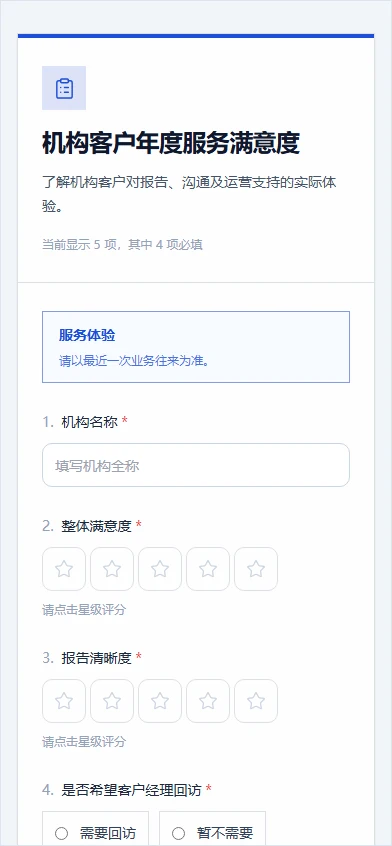
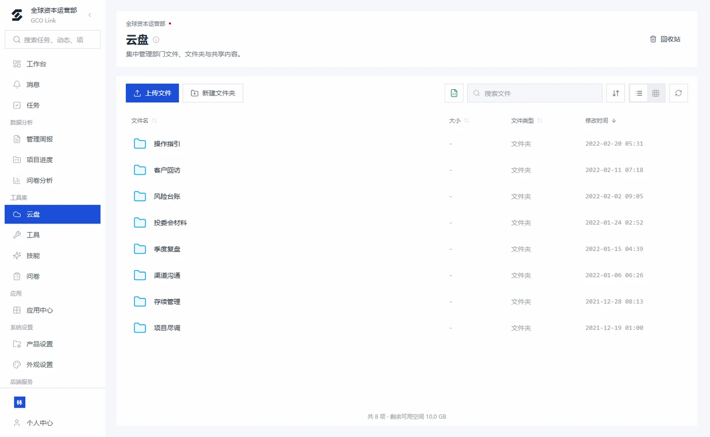
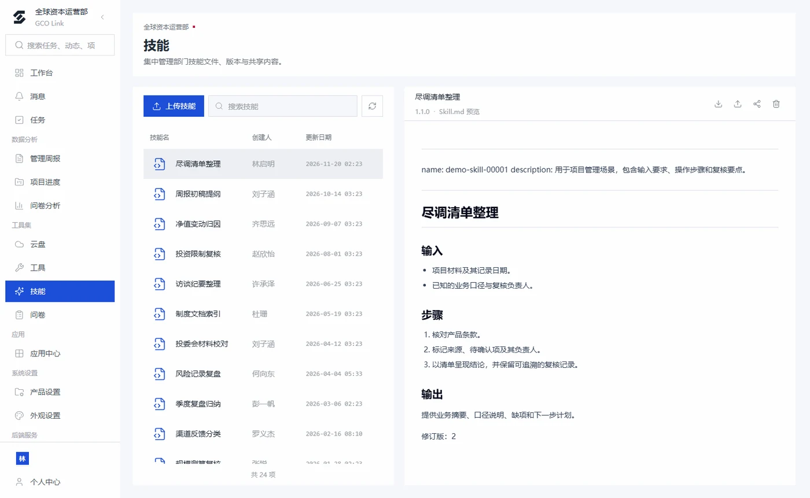
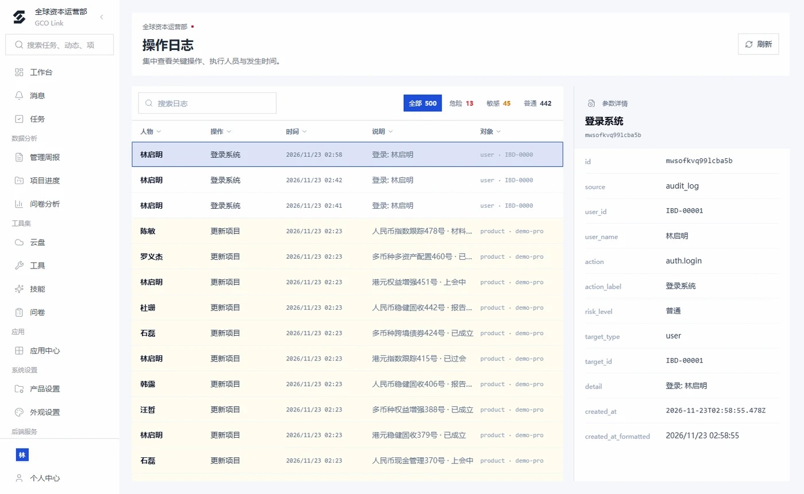

  <a href="./README.md">← 简体中文</a> &nbsp;·&nbsp; <strong>English</strong>

  

<h1 align="center">Department Hub · A departmental MIS</h1>

  A shared workspace for project progress, team assignments, weekly reports, business files, and client feedback.

  <strong><a href="https://gco.jimmyhuang.cn/">Try GCO Link online ↗</a></strong>
  &nbsp;·&nbsp; <a href="https://gco.jimmyhuang.cn/launch">Explore the product ↗</a>

  <a href="#workspace">Desktop and mobile</a> &nbsp;·&nbsp;
  <a href="#projects">Projects and tasks</a> &nbsp;·&nbsp;
  <a href="#reports">Weekly reports</a> &nbsp;·&nbsp;
  <a href="#resources">Files and tools</a> &nbsp;·&nbsp;
  <a href="#surveys">Surveys</a> &nbsp;·&nbsp;
  <a href="#governance">Administration</a> &nbsp;·&nbsp;
  <a href="#scenarios">Use cases</a> &nbsp;·&nbsp;
  <a href="#author">Author note</a>

---

**Department Hub** is a Management Information System (MIS) for business teams. When progress updates, conversations, and reporting materials are scattered across different places, managers struggle to see what needs their attention, and teammates have to piece together the context again at every handoff. Department Hub connects day-to-day work to a project register and preserves weekly records the team can return to.

The online instance is branded **GCO Link**. The workspace requires sign-in, and the application interface shown here is in Simplified Chinese. The screenshots use the same synthetic dataset, with **49 team members, 480 projects, 1,680 tasks, 10 surveys, and 2,669 responses**.

## Work through the detail on desktop. Follow up from your phone.

| Desktop | Mobile |
| :--- | :--- |
| Filter the project register and work through files, surveys, or reporting from a larger screen. | Switch between the dashboard, collaboration inbox, projects, and reports from the bottom navigation. |
| Open a task alongside the list to check the owner, attachments, and discussion. | Open an unread notification or mention and go straight to the related task. |
| Compare weekly records, edit the document preview, and export a Word report. | Look up the same project records during a meeting, a site visit, or a handoff. |

  
  &nbsp;&nbsp;
  

The team sees its collaboration inbox on the left. A survey respondent sees the public form on the right.

## Projects and tasks

### See where each project stands

The register records project stages, clients, owners, collaborators, deadlines, and business details. Cards make it easy to browse by stage, while the table helps compare many records at once. Narrow the workspace by week or owner, then open a project to find associated tasks and materials.

### Keep the work and its discussion together

Link a task to a project and set its owner, collaborators, due date, and priority. Add reference files to the task, then leave replies and mentions in its thread. Notifications for status updates and mentions take teammates back to the relevant discussion, so the next owner can see what happened before taking over.

## Weekly reporting and Word exports

Weekly reporting organizes project progress, issues, and next steps by week. Staff can focus on their own assignments; managers can review the current week by project category. Historical snapshots make it possible to compare what the team planned last week with what it completed this week.

The report editor brings together the selected week's records and manually entered priorities. Review the document preview, address any validation results, and export to Word. Previously generated reports remain available in the download history.

## Shared drive, spreadsheets, and team tools

The **shared drive** organizes working papers, meeting notes, and deliverables in folders. Team members can preview, download, or share files and associate them with the relevant project. The spreadsheet workspace supports lists and registers that need ongoing updates.

The **tools and skills library** holds reusable utilities, review checklists, and operating instructions. Team members can preview or download skill files and see their version history, which gives them a reference when a procedure changes or work moves to someone new.

## Surveys, from design to follow-up

### Build and share a form

Combine choice, text, rating, date, and attachment fields in the visual editor. Configure required fields and rules for when a question appears. For example, a satisfaction survey can ask for an email address only when the respondent requests a follow-up. Once published, a form can be shared through its public link or a QR code and filled in on a phone.

### Review responses and identify next actions

Review individual responses, response trends, and per-field statistics. Filter by handling status, inspect attachments, or export the results. When feedback needs action, the team can assign the follow-up in the task workspace.

## Administration and audit history

Manage users and roles, and give authorized team members access to administrative pages. Task editing is available to the creator, owner, or collaborators. Audit logs record who performed an action and when, with filters for tracing activity across projects, tasks, files, and surveys. The system also includes scheduled jobs and business-data backup and recovery.

## Where it fits

| Team | Example |
| :--- | :--- |
| **Business departments** | Identify upcoming deadlines and work that needs coordination before a weekly meeting. Capture the agreed next steps in the report. |
| **Operations teams** | Track document reviews, outstanding items, handoffs, and filing while retaining the evidence behind each decision. |
| **Project management teams** | Record owners and milestones for cross-team deliverables and review the history in the register and weekly snapshots. |
| **Client service teams** | Collect client feedback and supporting documents through surveys, then assign work on the responses that need follow-up. |

### Example: a quarterly client review

1. **Scope the work.** Find accounts due for review in the register and pull up the previous review notes.
2. **Assign the follow-up.** Create tasks with the relevant files, name the owners and collaborators, and set deadlines. Colleagues confirm the handoff from their mobile inbox.
3. **Collect feedback.** Clients open a shared survey link to submit their feedback or attach supporting material. The team reviews the responses and assigns any new follow-up.
4. **Report and retain the outcome.** Record what the team resolved and what remains open in the weekly report. At the next review, the team can pick up from the same project record.

## A note from the author

I built this system for my department while interning at a trust company in Shanghai in the summer of 2026, after my first year of university. The immediate problem was practical: project records lived in spreadsheets, assignments in messages, and progress updates came together only when it was time to write the weekly report. I wanted a shared workspace where colleagues could see the history of a piece of work and know whom to ask about the next step. The internal version is now in production and used by the department in its day-to-day work.

This repository is the open-source edition adapted from that internal system. Before publishing it, I removed internal data, credentials, company-specific branding, and features that were unsuitable for public release. The online demo and screenshots use fictional data. I hope Department Hub gives teams with similar needs a starting point they can learn from and adapt.

## License

This repository is licensed under the [MIT License](./LICENSE).

<strong><a href="https://gco.jimmyhuang.cn/">Open GCO Link ↗</a></strong> &nbsp;·&nbsp; <a href="./README.md">简体中文</a>

