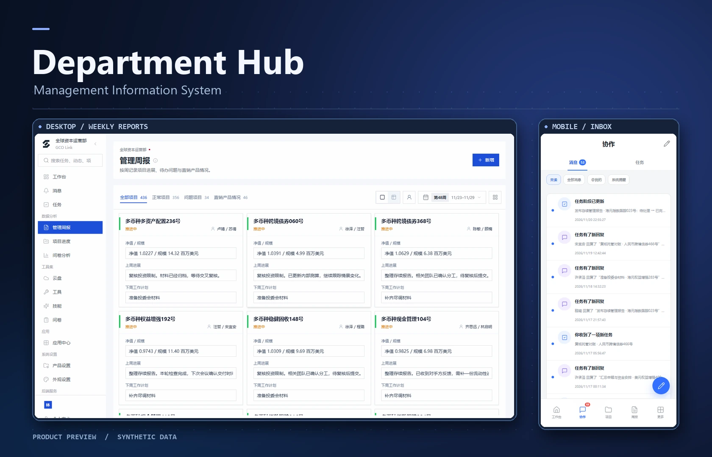

  <a href="./README.md">← 简体中文</a> &nbsp;·&nbsp; <strong>English</strong>

  

<h1 align="center">Departmental Management Information System (MIS)</h1>

  Run projects, assign work, and report progress in one workspace. Give everyone a clear view of what is moving, who owns it, and what needs attention next.

  <a href="#workspace">Desktop &amp; mobile</a> &nbsp;·&nbsp;
  <a href="#features">Core features</a> &nbsp;·&nbsp;
  <a href="#scenarios">Use cases</a>

---

## One set of records, two web interfaces

| Desktop · Work through the detail | Mobile · Stay on top of the day |
| --- | --- |
| Filter the project register by stage or owner, review past weekly reports, and analyze and export survey responses. | Check deadlines, see mentions, reply to tasks, and look up project progress on the go. Navigation, lists, and detail views are designed for a phone screen. |

Both interfaces work with the same projects, tasks, and reports. Work assigned from a desktop can be picked up on a phone. The application shown above uses a Simplified Chinese interface.

## From day-to-day work to management reporting

| Question | What Department Hub provides |
| :--- | :--- |
| **Where does the project stand?** | Track stages, owners, clients, and due dates in a project register with card and table views. |
| **Who owns the follow-up?** | Assign work, add collaborators, and keep replies, mentions, and attachments with the task. Notifications take users back to the relevant discussion. |
| **What changed this week?** | Record progress, blockers, and next steps. Compare past weekly snapshots and export a consolidated report to Word. |
| **Where are the files and procedures?** | Keep deliverables and spreadsheets in a shared drive and link them to projects. Store reusable tools and skills with version history. |
| **What feedback came in?** | Share public surveys with conditional questions, ratings, and attachments. Review responses by processing status, see statistics, and export results. |
| **Who changed what?** | Manage roles, review audit logs, schedule jobs, and back up or restore business data. |

## Where it fits

- **Business departments** can use the register to prepare for weekly reviews, surface overdue items and blockers, and preserve decisions in a report the team can revisit.
- **Operations teams** can track material reviews, missing documents, and handoffs in tasks. The next owner can see the evidence, attachments, and open questions in one thread.
- **Project management teams** can follow cross-team deliverables by owner and stage, then review milestones using linked files and historical snapshots.
- **Client service teams** can collect onboarding documents and feedback in surveys, track which responses need attention, and assign follow-up work to colleagues.

> **Example · A quarterly client review**
>
> A manager selects accounts due for review and assigns follow-up tasks with the previous meeting notes attached. Colleagues confirm who is handling each account from their phones. Once clients respond to the survey, the manager reviews the findings on desktop and brings unresolved issues into the weekly report. At the next review, the team can find the outcome on the same project record.
