

  <strong>简体中文</strong> &nbsp;·&nbsp; <a href="./README.en.md">English →</a>

  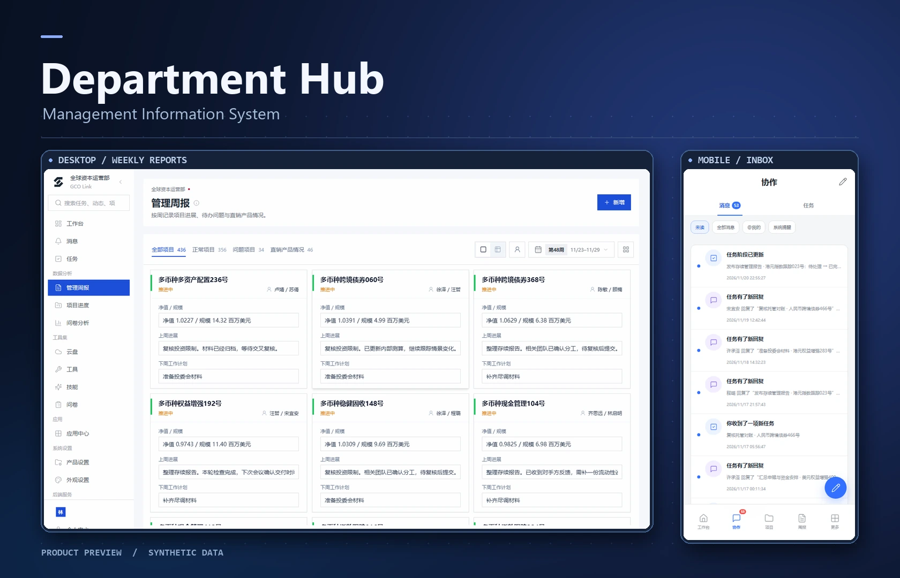

<h1 align="center">Department Hub · 部门级管理信息系统</h1>

  让项目进度、任务分工、每周汇报、业务资料和客户反馈在同一个部门工作台里接得起来。

  <strong><a href="https://gco.jimmyhuang.cn/">在线体验 GCO Link ↗</a></strong>
  &nbsp;·&nbsp; <a href="https://gco.jimmyhuang.cn/launch">查看产品介绍 ↗</a>

  <a href="#workspace">双端体验</a> &nbsp;·&nbsp;
  <a href="#projects">项目与任务</a> &nbsp;·&nbsp;
  <a href="#reports">管理周报</a> &nbsp;·&nbsp;
  <a href="#resources">资料与工具</a> &nbsp;·&nbsp;
  <a href="#surveys">问卷</a> &nbsp;·&nbsp;
  <a href="#governance">系统管理</a> &nbsp;·&nbsp;
  <a href="#scenarios">使用场景</a>

---

**Department Hub** 是面向业务团队的管理信息系统（MIS）。当项目进度、协作消息和汇报材料分散在不同地方，负责人很难判断哪些事项需要推动，接手的同事也得重新问一遍背景。Department Hub 把项目台账作为日常查询入口，让团队能沿着项目找到任务和资料，再按周回顾进展。

线上实例以 **GCO Link** 为名，工作台需登录。下文截图来自同一套虚构业务数据，包含 **49 位成员、480 个项目、1,680 项任务、10 份问卷和 2,669 份答卷**。

## 桌面集中处理，手机随时跟进

| 桌面端 | 移动端 |
| :--- | :--- |
| 查看项目全貌，筛选台账，处理成批的资料和答卷。 | 用底部导航切换工作台、协作、项目和周报。 |
| 在任务列表旁打开讨论详情，核对附件、负责人和回复。 | 打开未读消息或 @ 提及，回到任务查看进度和回复。 |
| 查看按周归档的项目情况，在预览中编辑小结并导出 Word。 | 开会、出差或交接时，随时查询同一项目的最新记录。 |

  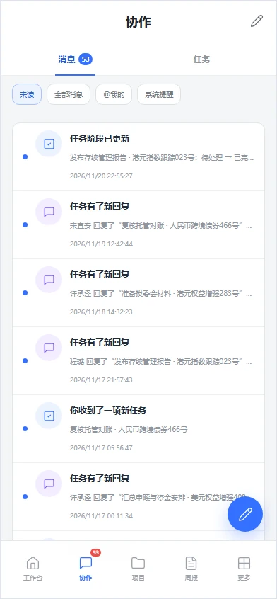
  &nbsp;&nbsp;
  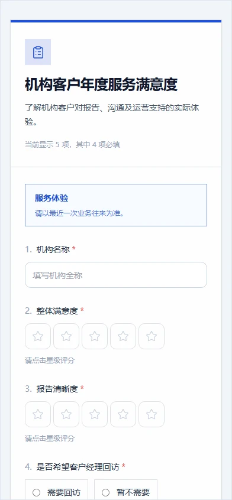

左侧是成员的移动端协作消息，右侧是客户打开分享链接后的填写页面。

## 项目台账与任务协作

### 从项目列表看进度和分工

项目台账记录项目阶段、客户、主责与协作人、到期时间和业务字段。卡片适合按阶段浏览，表格适合集中比较多条记录。负责人可以按项目周次和人员缩小范围，定位一项工作后查看关联资料或任务。

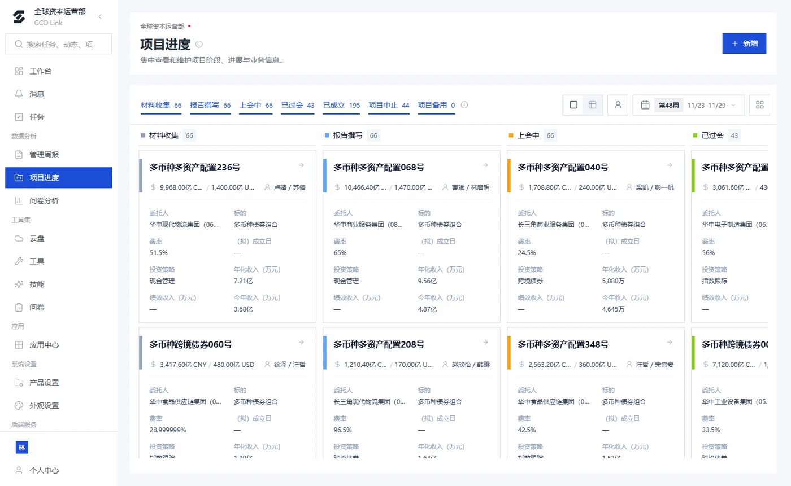

### 在任务里留下过程

一项任务可以关联项目，指定负责人、协作人、截止时间和优先级。需要复核的文件放在任务附件中，回复和 @ 提及按时间留在讨论里。收到状态变更或提及消息后，可以回到对应任务继续处理，交接时也有记录可查。

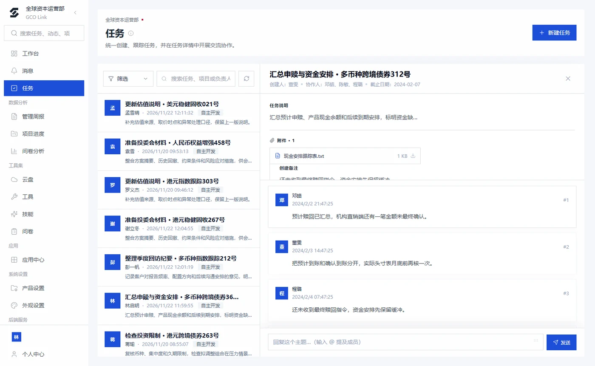

## 管理周报与 Word 小结

管理周报按周组织项目进展、问题说明和下步计划。成员可以切换「只看我的」，负责人可按项目类别查看当期情况。历史快照保留往周记录，例会上可以对照上一周的安排和这周的实际进展。

工作小结把当周数据和手填重点事项放进文档预览。出稿前可以核对内容、处理校验提示，再导出 Word。已生成的小结保留在历史下载中，方便补发或回顾。

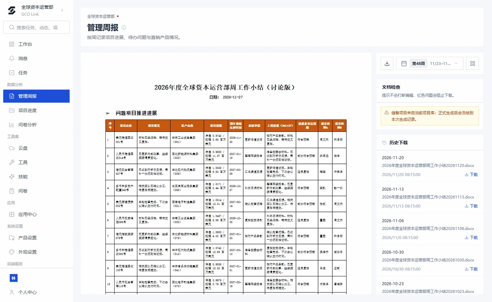

## 云盘、在线表格与部门工具

**云盘**按文件夹管理业务底稿、会议纪要和交付材料。文件可以预览、下载或分享，也能关联到具体项目，让项目成员从同一入口找到相关资料。「在线表格」适合记录需要持续更新的台账和清单。

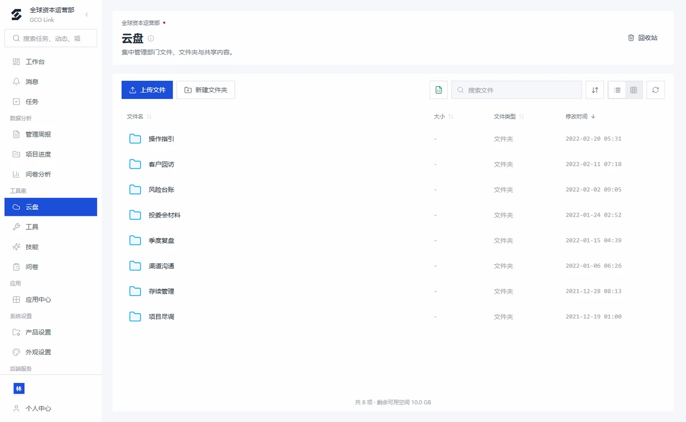

**工具与技能库**让团队集中保存常用工具、复核清单和操作说明。技能可以预览和下载，并保留发布版本。流程调整时，成员能查看当前版本及更新记录，交接时也有内容可循。

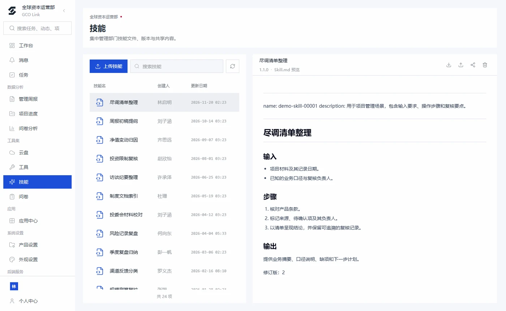

## 问卷，从设计到答卷处理

### 设计并分享

可在可视化编辑器中组合选择题、文本、评分、日期和附件等题型，为题目设置必填和条件显示。例如，服务满意度问卷中，客户选择「需要回访」后再显示联系邮箱。发布后，可复制填写链接或分享二维码，客户用手机也能填写。

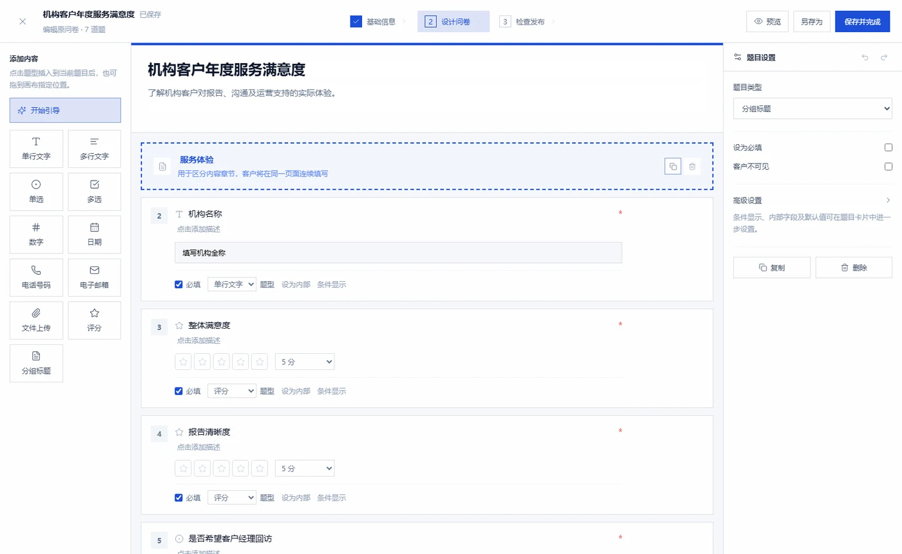

### 分析并跟进

部门成员可查看答卷明细、数据概览和字段统计，按处理状态筛选记录，查看附件或导出结果。负责回访的人可以先识别需要处理的意见，再到任务区分派后续工作。

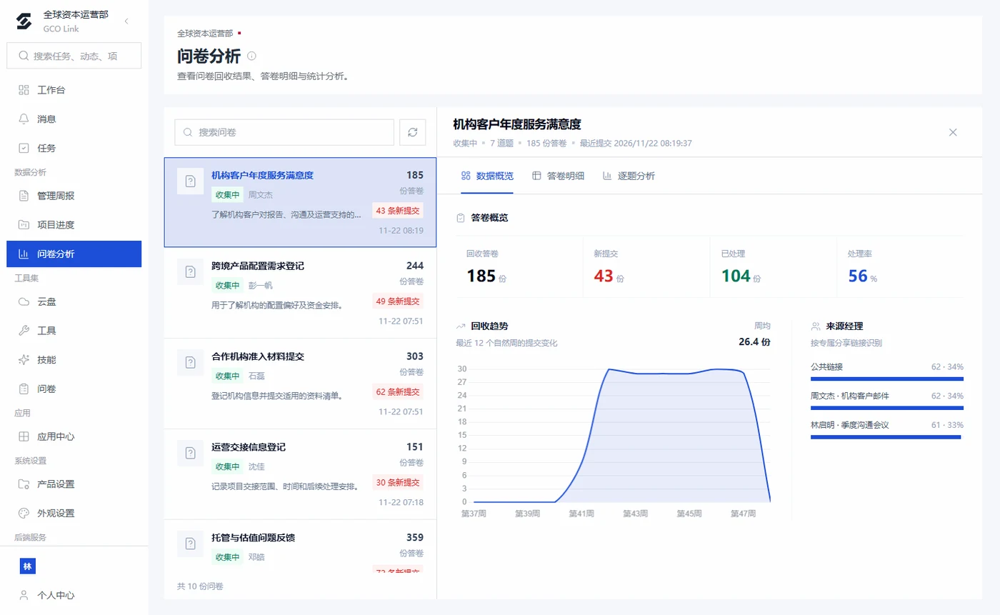

## 用户权限与操作追溯

系统提供用户管理和角色权限。任务创建人、负责人或协作人可以编辑任务，管理页面按角色开放。操作日志记录谁在什么时候处理了什么，支持按操作类型和执行人员追查项目、任务、文件或问卷活动。系统还提供定时任务、业务备份与恢复。

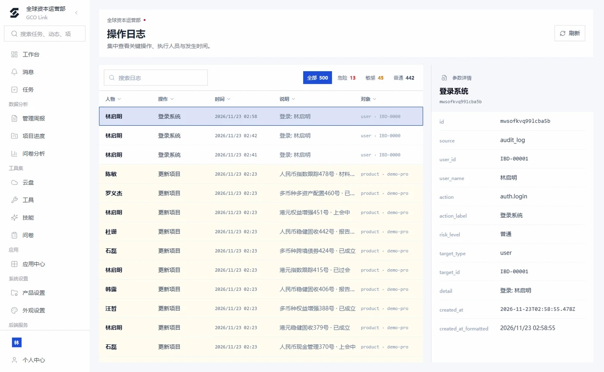

## 适用场景

| 团队 | 可以怎么用 |
| :--- | :--- |
| **业务部门** | 例会前按负责人查看到期和待协调项目，会上确定下一步，会后汇编周报。 |
| **运营团队** | 跟踪材料复核、补件、交接和归档，保留处理依据及最终版本。 |
| **项目管理团队** | 记录跨组交付、里程碑、主责和协作人，用台账与历史周报复盘。 |
| **客户服务团队** | 通过问卷收集客户意见和补充材料，将未完成的跟进分派给同事。 |

### 示例：一次季度客户回访

1. **确定范围**。负责人在项目台账中筛出到期客户，找到上次回访的记录和纪要。
2. **分派工作**。创建回访任务，附上历史资料，明确主责、协作人和交付时间。外出同事从手机消息进入任务确认分工。
3. **收集反馈**。客户打开问卷链接，按需填写回访意见或上传材料。部门成员查看答卷状态和统计，把需要跟进的问题整理成任务。
4. **汇报并留档**。本周处理结论进入管理周报，未结束的事项保留下步安排。下一轮回访时，团队可以从项目继续查阅。

<strong><a href="https://gco.jimmyhuang.cn/">打开 GCO Link ↗</a></strong> &nbsp;·&nbsp; <a href="./README.en.md">English version</a>

